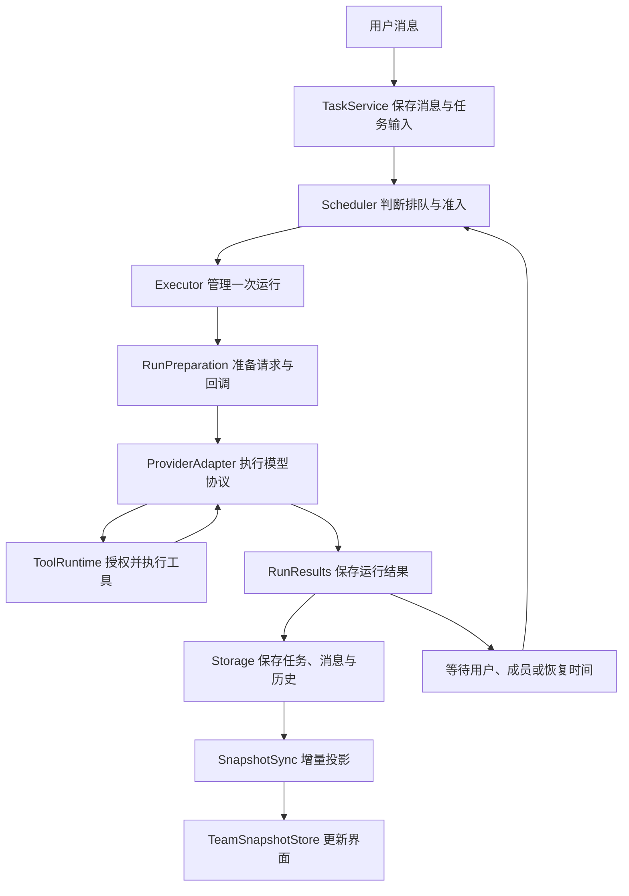

# 核心流程与维护入口

## 从一条消息到一次执行



应用请求从 `CoreService.request` 进入。维护准入检查之后，请求按领域分发到连接、团队、历史、成果或现有业务服务。`CoreService` 同时是依赖装配和启动、关闭、备份恢复编排的入口。

一次用户消息可能创建任务，也可能成为正在执行任务的补充输入。任务运行成功后，若仍有未接收输入或成员结果，任务会重新排队或等待成员。`Run` 保存一次执行的结果，`Task` 保存整个任务的进度，两者各自表达不同的生命周期。

## 调度与执行的阅读顺序

1. [tasks.ts](../src/core/tasks.ts)：消息保存、任务创建、补充输入接入、成员结果回传。
2. [scheduler.ts](../src/core/scheduler.ts)：候选任务、准入判断、执行名额和停止；[scheduler-recovery.ts](../src/core/scheduler-recovery.ts)：启动恢复。
3. [executor.ts](../src/core/executor.ts)：启动运行、执行 Provider、等待在途操作结束、选择结果保存路径、释放资源。
4. [run-preparation.ts](../src/core/run-preparation.ts)：目录准备、历史和提示词、图片、工具及检查点回调装配。
5. [run-results.ts](../src/core/run-results.ts)：完成、提问等待、恢复和失败时的持久化。

Scheduler 按现有优先级安排前台任务、主管代答和记忆整理，并检查依赖、成员资格、同成员同会话占用、账号额度与全局额度。排队展示与实际准入复用候选资料。取消请求先保存请求时间，再停止执行并等待实际收尾。

成功结束模型运行后，任务结果按以下优先级保存：

| 条件 | 任务状态 |
| --- | --- |
| 存在结果未知的工具操作或成员结果 | `interrupted`，等待对账 |
| 有尚未接收的补充输入 | `queued` |
| 仍有未结束或未回传的成员结果 | `waiting_children` |
| 本轮已完成且资料完整 | `completed` |

提问等待与模型恢复是独立路径。提问保存后释放执行名额，用户回答接续原任务；可恢复模型异常保留检查点与恢复时间，由 Scheduler 到期接续。

## 状态归属

| 状态 | 写入归属与读取入口 |
| --- | --- |
| 排队、运行、等待和任务结果 | `TaskService` 及运行结果保存事务；Scheduler 管理执行名额 |
| 本轮回复草稿 | `RunReplyWriter`；通过 `current` 读取当前消息，通过方法切换、发布或保留失败输出 |
| 补充消息的 pending / claimed / delivered | `TaskInputService`；用户与主管入口分别保留自己的授权检查 |
| 托管 Provider 运行中的消息、阶段、重试状态 | `ManagedRunState`；普通工具与提前工具通过状态方法写入 |
| 原始协议档案、工作投影与有效性 | `ManagedHistory`；运行结束在原结算事务中提交 |
| 工具操作 prepared / dispatched / succeeded / failed / unknown | `ToolOperationJournal`；ToolRuntime 负责授权、排队与派发顺序 |
| 文件观察版本与工具执行上下文 | `ToolContextFactory`；执行前继续读取当前授权 |
| MCP 初始化、连接、串行队列、目录修订和关闭 | `McpSessionManager`；`McpConnections` 保留授权、目录映射和工具调用业务 |
| 桌面 Core 子进程及未完成请求 | `CoreHost`；平台文件选择和系统操作在 `core-platform.ts` |
| 界面快照、会话选择与刷新队列 | 一个 `TeamSnapshotStore`；合并函数只计算投影 |

状态按职责就近保存。新增状态时应先确定唯一写入者，再选择现有存储或类作为归属；共享对象通过明确操作更新。

## 上下文、检查点与恢复

原始协议、工作上下文、摘要分别承担取证、模型输入和压缩职责。完整协议包含工具配对和不透明字段；工作投影可重建。`ManagedHistory` 集中历史加载、来源映射、归档提交和有效性保存，继续使用已有元数据键与档案格式。

Core 在 Provider 启动前准备恢复资料与运行上下文；Provider 开始执行后，运行中的可变状态由 `ManagedRunState` 管理。检查点保存成功后才确认补充输入已接收。

三个游标属于不同视图：

| 游标 | 含义 |
| --- | --- |
| `currentStart` | 工作投影中当前用户轮次的起点 |
| `archiveStart` | 当前运行在原始协议视图中的起点 |
| `compaction.start` | 压缩后工作投影中新增协议片段的起点 |

请求输入先持久化，再发送模型请求。完整 assistant 保存成功后才派发对应工具，结果逐项保存。普通执行、提前执行和增量重放共用 `insertOrderedToolResult`，按原调用顺序插入结果。恢复读取已保存结果，接续剩余操作；结果未知的副作用进入原有对账流程。

压缩只在完整工具边界替换工作投影，保留当前用户要求与原始资料。兼容性签名、绑定代次、来源版本和授权共同决定投影能否复用。

## 存储、通知与界面同步

`Storage` 是统一 SQLite 入口，负责实体、消息、运行事件、事务和表版本。`storage-schema.ts` 保存初始化表、索引与兼容迁移。业务事务仍由发起该业务操作的服务拥有。

流式片段先保存到运行事件，再由 MessageStream 合并到消息。发布、回复切换、检查点和运行终态前会刷新待合并文字。五类配置快照按表版本缓存，事务内读取和恢复后的失效继续由存储与缓存层处理。

业务变化和流式内容分别通知；桌面通知合并在当前同步事务结束后发布。SnapshotSync 持有同步 epoch 与版本游标，TeamSnapshotStore 分别管理会话选择代次和历史分页代次。必要的完整重载前先发布已经持久化的增量；旧会话及旧分页响应经过代次检查后才可应用。

## 依赖边界与表达规范

- Domain 定义模型与公共协议；Runtime 依赖 Domain；Provider 和 Tools 依赖 Domain 与 Runtime；Core 负责业务编排和持久化。
- UI 的共享模型来自 Domain；桌面进程的双向消息类型也位于 Domain。桌面继续拥有 Electron 平台能力。
- Biome 检查受限导入与运行时循环依赖。纯类型引用按编译后的运行时依赖规则处理。
- 手写 JS、TS、TSX 使用两空格、单引号、分号和 100 字符换行参考线。不同副作用分行书写，复杂分支使用具名条件或顺序判断。
- 有独立变化原因的职责提取为模块；强时序和共享状态继续集中。文件和函数规模按展开后的代码评估。

## 验证入口

| 变更 | 优先测试 |
| --- | --- |
| 调度、启动恢复、补充输入 | [scheduler](../tests/scheduler.test.ts)、[scheduler-recovery](../tests/scheduler-recovery.test.ts)、[task-input-admission](../tests/task-input-admission.test.ts)、[core-user-input](../tests/core-user-input.test.ts) |
| 执行结果、草稿、提问与停止 | [execution-lifecycle](../tests/execution-lifecycle.test.ts)、[run-publication](../tests/run-publication.test.ts)、[core-questions](../tests/core-questions.test.ts)、[task-controls](../tests/task-controls.test.ts) |
| 协议、历史、检查点与压缩 | [managed-history](../tests/managed-history.test.ts)、[managed-progress](../tests/managed-progress.test.ts)、[managed-progress-deltas](../tests/managed-progress-deltas.test.ts)、[managed-recovery-lifecycle](../tests/managed-recovery-lifecycle.test.ts)、[manual-compaction-mcp](../tests/manual-compaction-mcp.test.ts) |
| 工具权限、操作保存与 MCP 生命周期 | [core-permissions](../tests/core-permissions.test.ts)、[core-mcp-revocation](../tests/core-mcp-revocation.test.ts)、[tool-operation-lifecycle](../tests/tool-operation-lifecycle.test.ts)、[mcp-lifecycle](../tests/mcp-lifecycle.test.ts) |
| 存储、增量快照和桌面进程 | [storage-binding](../tests/storage-binding.test.ts)、[snapshot-cache](../tests/snapshot-cache.test.ts)、[snapshot-sync](../tests/snapshot-sync.test.ts)、[snapshot-store](../tests/snapshot-store.test.ts)、[core-host](../tests/core-host.test.ts) |

测试文件位于 `tests/`，以上名称对应 `.test.ts`。涉及本地 HTTP/WebSocket 的协议用例需要允许监听本机临时端口。

常用命令：

```sh
pnpm format
pnpm check
pnpm typecheck
pnpm exec vitest run tests/execution-lifecycle.test.ts
pnpm test
python3 -B -m unittest discover -s scripts/presets -p 'test_*.py'
pnpm build
```

`pnpm format` 只负责格式，`pnpm check` 在 CI 中只读检查格式与规则。完整验证复用已有 macOS、Windows CI；界面交互由用户手动验收。
