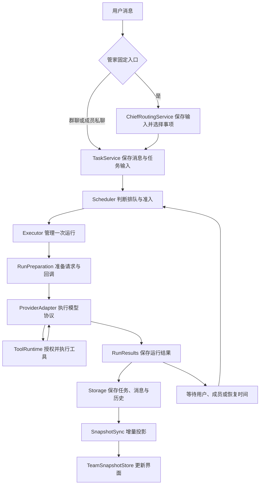

# 核心流程与维护入口

## 从一条消息到一次执行



应用请求从 `CoreService.request` 进入。维护准入检查之后，请求按领域分发到连接、团队、历史、成果或现有业务服务。`CoreService` 同时是依赖装配和启动、关闭、备份恢复编排的入口。

一次用户消息可能创建任务，也可能成为正在执行任务的补充输入。任务运行成功后，若仍有未接收输入或成员结果，任务会重新排队或等待成员。`Run` 保存一次执行的结果，`Task` 保存整个任务的进度，两者各自表达不同的生命周期。

## 管家主入口与工作事项

`settings.mainConversationId` 是固定可见主入口。每个 `ChiefWorkContext` 保存事项名称与当前 `ChiefContextPart`；工作段关联真实执行 `Conversation`，继续使用其工作区、消息、任务、绑定和权限。不同事项可以并发，同一事项沿现有任务补充输入规则串行接续。管家统一读取 Bot 的模型、推理强度和上下文配置，模型或连接变更须等待管家任务结束。

| 服务 | 权威状态与职责 |
| --- | --- |
| `ChiefRoutingService` | `ChiefInput` 接收、幂等、归属判断、澄清、重试、取消和派发 |
| `ChiefContextService` | 事项、工作段及当前焦点；实际进度读取 Task |
| `ChiefTimelineService` | `ChiefTimelineEntry` 的稳定显示顺序、消息引用与已读投影 |
| `ChiefHistoryService` | 管家直属历史检索、原消息锚点及确切来源授权 |
| `ChiefMaintenanceService` | 上下文压力判断、压缩或分段、来源校验与交接 |

`chief.inputs.send` 先在事务中保存输入和时间线引用，立即展示用户消息。明确事项、回复引用和明确接续语直接解析；其他请求用独立后台任务判断续接、新建或澄清。请求只携带有界候选资料，工具列表为空，返回的事项、项目和历史来源 ID 由 Core 校验。路由使用独立内部会话，受现有账号及全局调度限制。多个待输入按提交顺序处理，单条澄清释放后续输入；派发时在同一事务中创建正式消息并绑定原时间线条目，清除输入中的临时正文。

焦点记录手动选择的修订号。路由依据提交时焦点与修订号决定是否更新焦点；后台进展及完成通知只进入时间线。附件向派发的实际会话授予确切 ID；跨事项历史召回和任务成果查询也只保存实际返回的任务或成果授权。普通成员及群继续遵循原有来源绑定。

时间线只保存原消息或待派发输入的引用，原消息 ID、会话 ID 和序号保留。页面按独立显示序号分页，流式更新沿原消息 ID 合并；已读确认按真实来源分组保存。原会话分页继续服务历史、群聊和私聊。快照与增量携带 `chief` 目录、焦点和待输入，消息投影附带事项与显示序号。

迁移在调度恢复前选择普通管家主入口，保留其消息为时间线基线；其他旧对话作为历史保留。活动旧任务沿用原会话及绑定并接入事项，新输出进入统一时间线。已完成旧任务首次继续时创建关联事项与执行会话，带入相关原文、成果及历史任务引用。例行工作保留专用内部会话，汇报统一进入主入口。迁移版本和映射持久保存，重复迁移保持稳定。

SQLite 存储兼容版本为 2，新备份格式为 3。新备份保存事项、段、输入和时间线关系，旧备份恢复后执行同样迁移；尚未派发的恢复输入保留正文，等待用户重试。历史全文索引采用 FTS5 trigram、短词匹配和相关性排序，后台分批重建，查询先限定获准的管家直属历史。`recall_work` 返回候选，`read_work_history` 按原消息锚点展开原文及成果。

上下文达到配置阈值后，活动任务继续沿现有完整工具边界压缩。事项收尾后，维护任务判断压缩续做或切换新段。切段前检查任务树、待输入、问答、审批、命令和待对账操作；摘要包含目标、约束、进度、决定、待办、成果及历史位置，并保存近期用户原文引用。来源指纹再次校验成功后原子创建新段，更新当前指针。整理期间输入持久等待，维护锁释放时通知路由接续。工作段与 `SessionBinding.generation` 分别表示工作接续和配置兼容性。

## 调度与执行的阅读顺序

1. [tasks.ts](../src/core/tasks.ts)：消息保存、任务创建、补充输入接入、成员结果回传。
2. [scheduler.ts](../src/core/scheduler.ts)：候选任务、准入判断、执行名额和停止；[scheduler-recovery.ts](../src/core/scheduler-recovery.ts)：启动恢复。
3. [executor.ts](../src/core/executor.ts)：启动运行、执行 Provider、等待在途操作结束、选择结果保存路径、释放资源。
4. [run-preparation.ts](../src/core/run-preparation.ts)：目录准备、历史和提示词、图片、工具及检查点回调装配。
5. [run-results.ts](../src/core/run-results.ts)：完成、提问等待、恢复和失败时的持久化。

Scheduler 按现有优先级安排前台任务、主管代答和记忆整理，并检查依赖、成员资格、同成员同会话占用、账号额度与全局额度。排队展示与实际准入复用候选资料。取消请求先保存请求时间，再停止执行并等待实际收尾。

成功结束模型运行后，任务结果按以下优先级保存：

| 条件 | 任务状态 |
| --- | --- |
| 存在结果未知的工具操作或成员结果 | `interrupted`，等待对账 |
| 有尚未接收的补充输入 | `queued` |
| 仍有未结束或未回传的成员结果 | `waiting_children` |
| 本轮已完成且资料完整 | `completed` |

提问等待与模型恢复是独立路径。提问保存后释放执行名额，用户回答接续原任务；可恢复模型异常保留检查点与恢复时间，由 Scheduler 到期接续。

## 状态归属

| 状态 | 写入归属与读取入口 |
| --- | --- |
| 排队、运行、等待和任务结果 | `TaskService` 及运行结果保存事务；Scheduler 管理执行名额 |
| 本轮回复草稿 | `RunReplyWriter`；通过 `current` 读取当前消息，通过方法切换、发布或保留失败输出 |
| 补充消息的 pending / claimed / delivered | `TaskInputService`；用户与主管入口分别保留自己的授权检查 |
| 托管 Provider 运行中的消息、阶段、重试状态 | `ManagedRunState`；普通工具与提前工具通过状态方法写入 |
| 原始协议档案、工作投影与有效性 | `ManagedHistory`；运行结束在原结算事务中提交 |
| 工具操作 prepared / dispatched / succeeded / failed / unknown | `ToolOperationJournal`；ToolRuntime 负责授权、排队与派发顺序 |
| 文件观察版本与工具执行上下文 | `ToolContextFactory`；执行前继续读取当前授权 |
| MCP 初始化、连接、串行队列、目录修订和关闭 | `McpSessionManager`；`McpConnections` 保留授权、目录映射和工具调用业务 |
| 桌面 Core 子进程及未完成请求 | `CoreHost`；平台文件选择和系统操作在 `core-platform.ts` |
| 界面快照、会话选择与刷新队列 | 一个 `TeamSnapshotStore`；合并函数只计算投影 |

状态按职责就近保存。新增状态时应先确定唯一写入者，再选择现有存储或类作为归属；共享对象通过明确操作更新。

最终回复通过 `reply-artifacts.ts` 自动附加尚未发表的最新交付文件，同任务已通过 `post_message` 发出的文件沿用原消息；显式重发仍保留。启动与备份恢复时校正历史最终回复的重复附件关联，原文件和消息正文保留。

库与自动交付共用 `latestArtifactVersions`，显式版本系列优先，其余按事项、智能体和工作路径选择最新文件；旧成果沿用原会话归属。同事项跨段修改连续显示，库按事项分组并标注项目，历史版本折叠保留。真实产出者、任务、成果 ID 和正文持续保存。

聊天中的 AI 附件、工作记录的成果列表和库统一通过 `isDeliverableArtifact` 筛选最终交付。用户上传的资料保留在自己的消息中，工具全文、文档预览页等过程文件供内部读取。库将内容不同的历史交付版本折叠在当前成果下。

`ArtifactObjects` 按 SHA256 保存不可变正文，各会话、智能体和任务仍有独立成果记录与授权。文件名别名优先通过只读硬链接共享正文，文件系统不支持时使用副本；`registerTaskArtifact` 复用同一任务内内容、来源和版本一致的登记。旧 App 副本在空闲时分批迁移，引用 ID 保持稳定。

`ArtifactStorage` 管理容量统计、策略和后台回收。派生图片与文档页面统一按内容及转换参数缓存，默认总额度 512 MiB、闲置 7 天回收，活动转换受保护；工具 TXT 沿用独立的可重建正文缓存。未发送上传附件使用草稿租期，24 小时失去续租且没有持久引用后回收，删除前在同一同步边界复核租期与引用。交付成果、历史版本和工作区原文件持续保留。备份暂停维护并导出独立正文，恢复后可再次共享内容。

## 上下文、检查点与恢复

原始协议、工作上下文、摘要分别承担取证、模型输入和压缩职责。完整协议包含工具配对和不透明字段；工作投影可重建。`ManagedHistory` 集中历史加载、来源映射、归档提交和有效性保存，继续使用已有元数据键与档案格式。

Core 在 Provider 启动前准备恢复资料与运行上下文；Provider 开始执行后，运行中的可变状态由 `ManagedRunState` 管理。检查点保存成功后才确认补充输入已接收。

三个游标属于不同视图：

| 游标 | 含义 |
| --- | --- |
| `currentStart` | 工作投影中当前用户轮次的起点 |
| `archiveStart` | 当前运行在原始协议视图中的起点 |
| `compaction.start` | 压缩后工作投影中新增协议片段的起点 |

请求输入先持久化，再发送模型请求。完整 assistant 保存成功后才派发对应工具，结果逐项保存。普通执行、提前执行和增量重放共用 `insertOrderedToolResult`，按原调用顺序插入结果。恢复读取已保存结果，接续剩余操作；结果未知的副作用进入原有对账流程。

压缩只在完整工具边界替换工作投影，保留当前用户要求与原始资料。兼容性签名、绑定代次、来源版本和授权共同决定投影能否复用。

托管模型只调整推理强度时保留绑定和检查点。Core 的 `run-reasoning.ts` 在模型请求边界读取当前设置，Provider 为本次请求保存独立配置快照，当前流和工具继续使用原运行上下文。更换模型、连接或账号仍触发原有代次隔离；原生通道在后续运行应用新配置。

官方 Responses 仅在模型目录声明支持时使用 `configuration_update`。可信的 `reasoningUpdate` 历史条目保存请求强度基线和后续选择，随现有协议档案及检查点持久化，发送前保存成功；相邻配置仅在请求副本中合并，原始历史保持完整。配置更新不参与语义摘要，成功压缩后从工作投影清除，下次请求按当前强度建立新基线；失败或未压缩时保留原基线。其他端点、能力未知或供应商自定义档位保持请求级推理参数，完整历史与已完成工具结果继续复用。

## 存储、通知与界面同步

`Storage` 是统一 SQLite 入口，负责实体、消息、运行事件、事务和表版本。`storage-schema.ts` 保存初始化表、索引与兼容迁移。业务事务仍由发起该业务操作的服务拥有。

流式片段先保存到运行事件，再由 MessageStream 合并到消息。发布、回复切换、检查点和运行终态前会刷新待合并文字。五类配置快照按表版本缓存，事务内读取和恢复后的失效继续由存储与缓存层处理。

业务变化和流式内容分别通知；桌面通知合并在当前同步事务结束后发布。任务更新和已读确认可显式选择增量投影，仍按业务变化即时唤醒调度及补充输入监听。`state.changes` 的 `businessDeltas` 参数使客户端接收受影响会话、任务安排和补充输入；省略参数沿用原有完整刷新策略。消息变化只重算相关会话的未读数，完整快照仍提供全局列表。配置、需求变更、删除、恢复及未支持的投影变化继续完整刷新。

SnapshotSync 持有同步 epoch 与版本游标，TeamSnapshotStore 分别管理会话选择代次和历史分页代次。必要的完整重载前先发布已经持久化的增量；旧会话及旧分页响应经过代次检查后才可应用。消息顺序由合并层维护，空增量只推进游标，未变更的消息保持对象引用；聊天 Markdown 按正文复用渲染结果。

发送消息时按当前会话查询一次接收任务候选，排队任务的补充输入按任务索引查询。群聊各成员复用本次候选集合，仍按原有状态优先级及创建时间选择任务。上下文压缩仅在单次调用内复用 Token 估值，保持协议、摘要边界和持久化格式一致。

## 依赖边界与表达规范

- Domain 定义模型与公共协议；Runtime 依赖 Domain；Provider 和 Tools 依赖 Domain 与 Runtime；Core 负责业务编排和持久化。
- UI 的共享模型来自 Domain；桌面进程的双向消息类型也位于 Domain。桌面继续拥有 Electron 平台能力。
- Biome 检查受限导入与运行时循环依赖。纯类型引用按编译后的运行时依赖规则处理。
- 手写 JS、TS、TSX 使用两空格、单引号、分号、LF 换行和 100 字符换行参考线。Git 检出与 Biome 使用相同换行规则；固定摘要资料保留原始字节。不同副作用分行书写，复杂分支使用具名条件或顺序判断。
- 有独立变化原因的职责提取为模块；强时序和共享状态继续集中。文件和函数规模按展开后的代码评估。

## 验证入口

桌面更新只保存一个校验完成的候选包及原子写入的缓存记录。启动仍读取官方清单，平台、版本、大小与摘要匹配且文件复验通过后恢复安装入口；清单请求失败保留缓存。安装助手在任务目录记录实际进程 ID，回收避开仍在使用的源包，安装前继续复验文件并执行任务准入检查。

Release 草稿上传复用已校验安装包，并查询包源提交 SHA 对应的最新日常 CI。最新运行及 macOS、Windows 检查均成功后才允许上传；查询期间运行或重试轮次变化需要重新校验。

| 变更 | 优先测试 |
| --- | --- |
| 管家输入、迁移、历史、分段与展示 | [chief-routing](../tests/chief-routing.test.ts)、[chief-contracts](../tests/chief-contracts.test.ts)、[chief-history](../tests/chief-history.test.ts)、[chief-maintenance](../tests/chief-maintenance.test.ts)、[chief-maintenance-routing](../tests/chief-maintenance-routing.test.ts)、[chief-compat](../tests/chief-compat.test.ts)、[chief-work-ui](../tests/chief-work-ui.test.ts) |
| 调度、启动恢复、补充输入 | [scheduler](../tests/scheduler.test.ts)、[scheduler-recovery](../tests/scheduler-recovery.test.ts)、[task-input-admission](../tests/task-input-admission.test.ts)、[core-user-input](../tests/core-user-input.test.ts) |
| 执行结果、草稿、提问与停止 | [execution-lifecycle](../tests/execution-lifecycle.test.ts)、[run-publication](../tests/run-publication.test.ts)、[core-questions](../tests/core-questions.test.ts)、[task-controls](../tests/task-controls.test.ts) |
| 文件交付、历史附件与库版本 | [reply-artifacts](../tests/reply-artifacts.test.ts)、[artifact-groups](../tests/artifact-groups.test.ts)、[artifact-delete](../tests/artifact-delete.test.ts) |
| 协议、历史、检查点与压缩 | [managed-history](../tests/managed-history.test.ts)、[managed-progress](../tests/managed-progress.test.ts)、[managed-progress-deltas](../tests/managed-progress-deltas.test.ts)、[managed-recovery-lifecycle](../tests/managed-recovery-lifecycle.test.ts)、[manual-compaction-mcp](../tests/manual-compaction-mcp.test.ts) |
| 工具权限、操作保存与 MCP 生命周期 | [core-permissions](../tests/core-permissions.test.ts)、[core-mcp-revocation](../tests/core-mcp-revocation.test.ts)、[tool-operation-lifecycle](../tests/tool-operation-lifecycle.test.ts)、[mcp-lifecycle](../tests/mcp-lifecycle.test.ts) |
| 存储、增量快照和桌面进程 | [storage-binding](../tests/storage-binding.test.ts)、[snapshot-cache](../tests/snapshot-cache.test.ts)、[snapshot-sync](../tests/snapshot-sync.test.ts)、[snapshot-store](../tests/snapshot-store.test.ts)、[core-host](../tests/core-host.test.ts) |

测试文件位于 `tests/`，以上名称对应 `.test.ts`。涉及本地 HTTP/WebSocket 的协议用例需要允许监听本机临时端口。

常用命令：

```sh
pnpm format
pnpm check
pnpm typecheck
pnpm exec vitest run tests/execution-lifecycle.test.ts
pnpm test
python3 -B -m unittest discover -s scripts/presets -p 'test_*.py'
pnpm build
```

`pnpm format` 只负责格式，`pnpm check` 在 CI 中只读检查格式与规则。完整验证复用已有 macOS、Windows CI；界面交互由用户手动验收。
